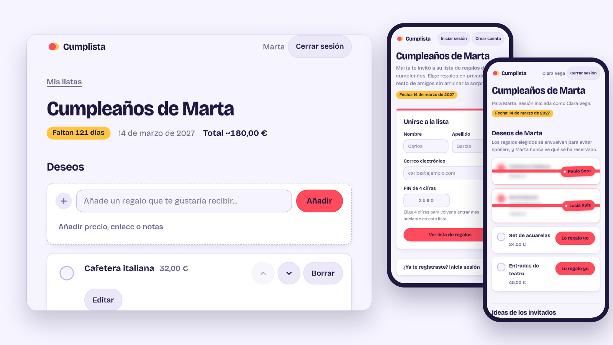
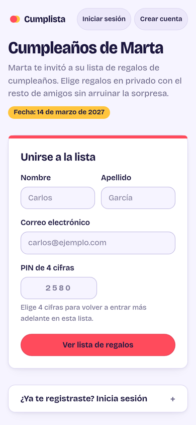
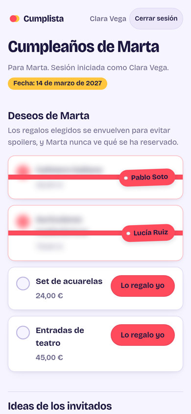
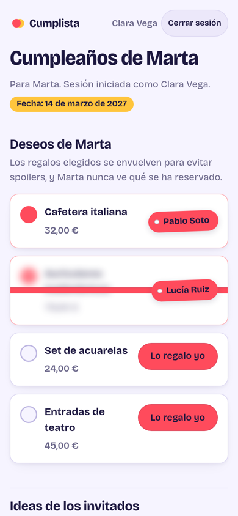

<p align="center">
  
</p>

<h1 align="center">Cumplista</h1>

<p align="center">
  Birthday gift lists without spoilers.<br>
  One link, no apps to install, and the birthday person never sees who is buying what.
</p>

<p align="center">
  <a href="https://github.com/YellowUmbrellaDev/cumplista/actions/workflows/ci.yml"></a>
  <a href="LICENSE"></a>
  
  
</p>

<p align="center">
  
</p>

## What it does

You write a wish list for your birthday. You share one link with your friends. They sign up in a minute, see the list and reserve what they will give. Everyone else sees that a gift is taken and by whom, so nobody buys the same thing twice. You see none of it, so the surprise stays intact.

- **One invite link per list.** Friends open it, enter a first name, last name, email and a 4-digit PIN, and they are in. They sign back in with email and PIN. Sessions last a year.
- **Reserved gifts are wrapped.** A taken gift is blurred and shows a gift tag with the name of whoever reserved it. A tap reveals it.
- **Side gifts.** A guest can add a gift that is not on the list, so other guests know it is covered. Only guests see these.
- **A real account for the owner.** Email and password, or Google sign-in. One account can own many lists, one per birthday.
- **Spanish and English.** Adding a language is one typed file and one registry line.
- **Runs anywhere.** The same app runs on a small server with SQLite, or on Cloudflare Workers with D1.

## Screenshots

<p align="center">
  
  &nbsp;
  
  &nbsp;
  
</p>

## Privacy by structure

The owner never sees guests, how many there are, who reserved what, or the gifts guests add. This is not a setting. The owner-side modules (`lists`, `users`, `invite`, `password` and the owner and account routes) never mention the `guests`, `claims` or `side_gifts` tables, and a test fails if one ever does. A second test signs guests up, reserves gifts and adds side gifts, then checks that no owner page or redirect contains any of it.

Cumplista runs on trust. An owner who really wants to peek can register as a guest with their own link, and the app does not try to stop that. See [docs/configuration.md](docs/configuration.md) for the full list of known limits.

## Quick start

You need Node 24 or newer. There is no database server to set up, because the app creates its SQLite file on first start.

```sh
git clone https://github.com/YellowUmbrellaDev/cumplista.git
cd cumplista
npm ci
npm start
```

Open <http://localhost:8787>, create an account and make a list. In development, password reset emails are printed to the console.

For a real server, set `NODE_ENV=production`, a `SESSION_SECRET` of at least 32 characters and your public `APP_URL`. The [self-hosting guide](docs/self-hosting.md) covers the rest, including Docker, a systemd unit, a reverse proxy with TLS and backups.

## Deploy it

| Option | Good for | Guide |
| --- | --- | --- |
| A server you control (Node and SQLite) | A VPS, a home server, a Raspberry Pi, Docker | [Self-hosting](docs/self-hosting.md) |
| Cloudflare Workers (D1) | No server to maintain, deploys from GitHub Actions | [Cloudflare Workers](docs/cloudflare-workers.md) |

Workers needs the Paid plan, because hashing passwords with 100000 PBKDF2 iterations takes more CPU time than the Free plan allows. The Cloudflare guide explains why.

## Documentation

| Guide | What is in it |
| --- | --- |
| [Self-hosting](docs/self-hosting.md) | Run on Node: configuration, data and backups, reverse proxy, systemd, Docker |
| [Cloudflare Workers](docs/cloudflare-workers.md) | D1, secrets, email, custom domain, CI/CD |
| [Configuration](docs/configuration.md) | Every environment variable, limits and caps, adding a language |
| [Integrations](docs/integrations.md) | Turnstile, Google sign-in, mail drivers |
| [Architecture](docs/architecture.md) | How the code is organised, the data model, auth and sessions |
| [Development](docs/development.md) | Running tests, CI, adding a migration, a route or a language |
| [AGENTS.md](AGENTS.md) | Rules for coding agents and contributors |

## Optional integrations

Everything below is off unless you configure it.

- **Cloudflare Turnstile.** An invisible human check on owner signup, guest registration and the forgot-password form. Nobody sees a puzzle unless Cloudflare doubts they are human.
- **Google sign-in.** Authorization code flow with PKCE and the scopes `openid email profile`.
- **Email.** Used only to reset an owner's password. Drivers for Cloudflare Email Sending, Resend and SMTP, plus a console driver for development.

## Built with

[Hono](https://hono.dev) with server-rendered JSX, TypeScript, and a few lines of vanilla JavaScript for progressive enhancement. SQLite through `node:sqlite` on Node, D1 on Workers. The only runtime dependencies are `hono`, `@hono/node-server` and `nodemailer`.

## Contributing

Issues and pull requests are welcome. Open an issue first for anything large. Run `npm run typecheck` and `npm test` before you send a change, and add a test for any behaviour you change. [docs/development.md](docs/development.md) has the details, and [AGENTS.md](AGENTS.md) lists the rules that matter most, especially the privacy boundary.

## License

Cumplista is free software under the [GNU Affero General Public License v3.0](LICENSE). If you run a modified version as a network service, you must offer its source to the people who use it.

Copyright (C) 2026 Yellow Umbrella.
