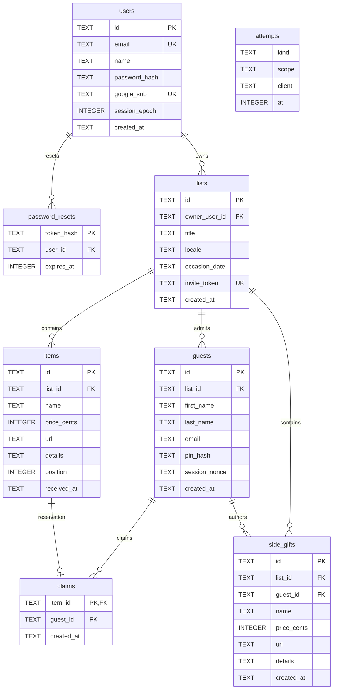

# Architecture

Cumplista runs one Hono application, created in [`src/app.ts`](../src/app.ts), on two runtimes. [`src/entry-node.ts`](../src/entry-node.ts) supplies SQLite, mail and HTTP server adapters. [`src/entry-worker.ts`](../src/entry-worker.ts) supplies Cloudflare D1 and Worker bindings. Both assemble the same `Deps` object and call `createApp`.

[`src/ports.ts`](../src/ports.ts) defines the boundaries: `Sql` provides queries and transactional batches, `Mailer` sends messages, `Captcha` verifies Turnstile responses, and `GoogleAuth` handles Google authorization and code exchange. `Deps` adds configuration, a clock and runtime-specific client IP resolution. Domain functions receive these dependencies instead of importing runtime services.

Pages render on the server with `hono/jsx`. There is no client framework. Forms submit ordinary POST requests, usually followed by redirects. Node serves `public/` through the Node adapter; Workers serves it through the configured assets directory. The small [`public/app.js`](../public/app.js) adds native sharing, clipboard copying with temporary feedback, click-to-select invite URLs, and mouse or keyboard reveal toggles for wrapped gifts.

## Source map

Paths below are relative to `src/`.

| Path | Responsibility |
| --- | --- |
| `app.ts` | Creates the app, checks request origins, mounts route groups and handles errors. |
| `ports.ts` | Runtime interfaces, configuration and dependency types. |
| `entry-node.ts` | Validates Node configuration, assembles adapters, serves assets and handles shutdown. |
| `entry-worker.ts` | Validates Worker bindings and assembles dependencies for each request. |
| `adapters/` | Implementations of external service and storage ports. |
| `adapters/sqlite.ts` | `node:sqlite` storage, startup migrations and transactions. |
| `adapters/d1.ts` | D1 query and batch adapter. |
| `adapters/mail.ts` | Console, Cloudflare email, Resend and SMTP delivery. |
| `adapters/captcha.ts` | Optional Turnstile verification with a timeout. |
| `adapters/google.ts` | Google PKCE URLs, token exchange and profile parsing. |
| `domain/` | Authentication, list operations and guest coordination. |
| `domain/types.ts` | Branded identifiers, records, principals and result unions. |
| `domain/auth.ts` | Random identifiers, token validation, signatures and origin comparison. |
| `domain/password.ts` | Password and PIN validation, hashing and verification. |
| `domain/users.ts` | Owner signup, login, password resets and Google account linking. |
| `domain/lists.ts` | Lists, owner items, ordering, received status and invite rotation. |
| `domain/invite.ts` | Invite URLs and translated share links. |
| `domain/guests.ts` | Per-list guest registration, login and session lookup. |
| `domain/claims.ts` | Guest item states and claim or release operations. |
| `domain/ideas.ts` | Guest-authored side gifts. |
| `domain/rate.ts` | Atomic attempt reservations for rate limits. |
| `domain/ip.ts` | Normalises client addresses into rate-limit buckets. |
| `routes/` | HTTP handlers and request parsing. |
| `routes/account.ts` | Public pages, owner authentication, language selection and password resets. |
| `routes/owner.ts` | Dashboard and authenticated owner mutations. |
| `routes/guest.ts` | Invite entry, guest authentication, claims and side gifts. |
| `routes/http.ts` | Shared cookies, session resolution, locale selection and form reading. |
| `routes/forms.ts` | Validates dates, item drafts, movement and received actions. |
| `views/` | Server-rendered pages and their inputs. |
| `views/props.ts` | Typed page inputs and shared page chrome. |
| `views/layout.tsx` | Document shell, assets, navigation and language controls. |
| `views/components.tsx` | Form components, formatting, icons and Turnstile widget. |
| `views/pages.tsx` | Account, dashboard, owner, invite and guest pages. |
| `i18n/` | Translation registry and locale selection. |
| `i18n/index.ts` | `LOCALES`, typed messages and translation functions. |
| `i18n/locales/` | Language dictionaries. |
| `i18n/locales/en.ts` | English dictionary and message-key source. |
| `i18n/locales/es.ts` | Spanish dictionary checked against `Messages`. |

## Privacy boundary

The owner path manages lists and items without reading guest coordination data. Owner modules must never reference the tables `guests`, `claims` or `side_gifts`. `OwnerItem` contains item details and received status, with no claim field. Side gifts live in a separate table rather than relying on owner queries to filter them out.

The `STATIC PRIVACY` test in [`test/cumplista.test.ts`](../test/cumplista.test.ts) scans this exact list for those table names:

- `src/domain/lists.ts`
- `src/domain/users.ts`
- `src/domain/invite.ts`
- `src/domain/password.ts`
- `src/routes/owner.ts`
- `src/routes/account.ts`

It separately checks that `routes/owner.ts` does not import `domain/guests`, `domain/claims` or `domain/ideas`. Those three domain modules and `routes/guest.ts` form the guest side. `routes/http.ts`, domain types, views and adapters provide shared infrastructure; the static check does not scan the whole import graph. A separate HTTP privacy test checks owner pages, mutation responses and redirects for guest identities, claims, side gifts and guest counts.

This is a boundary between application views. A person with direct database access can read the stored guest data.

## Data model

[`migrations/0001_init.sql`](../migrations/0001_init.sql) creates eight application tables:

| Table | Meaning |
| --- | --- |
| `users` | Owner accounts with password authentication, Google authentication or both. |
| `password_resets` | Hashed, expiring reset tokens belonging to an owner. |
| `lists` | An owner's gift list and its single shared invite token. |
| `items` | Owner-authored gifts, their ordering and received status. |
| `guests` | Guest accounts scoped to one list, with PIN hashes and session nonces. |
| `claims` | One guest's reservation of an owner-authored item. |
| `side_gifts` | Gifts added by guests outside the owner's items, implicitly reserved by their authors. |
| `attempts` | Timestamped operation reservations used by rate limits. |



All declared foreign keys cascade on deletion. Guest email uniqueness is the pair `(list_id, email)`; owner emails are globally unique. Both are stored lowercase. Nullable prices are integer cents and cannot be negative. `claims.item_id` is the primary key, so concurrent claims have one winner. `attempts` has no declared primary or foreign key. The Node adapter also maintains an internal `_migrations` tracking table.

## Authentication and sessions

The owner cookie is `cp_owner`. Its signed JSON principal contains `{ role: "owner", userId, epoch }`. Each request resolves the user using both `id` and `users.session_epoch`. A password reset increments that epoch. Linking Google to an existing password account also increments it and clears the old password hash, invalidating previous owner sessions.

Each list has a separate guest cookie named `cp_g_<listId>`. Its principal contains `{ role: "guest", listId, guestId, nonce }`. Resolution checks the list, guest and `guests.session_nonce` together. Changing the stored nonce invalidates that guest's existing cookies, but ordinary guest login reuses it. There is no nonce-rotation endpoint. Rotating the invite token changes entry through `/i/:token`, without revoking registered guest accounts or sessions.

Both cookie values use `base64url(JSON).base64url(signature)`, signed with HMAC-SHA256 and `SESSION_SECRET`. They are signed, not encrypted. Session principals contain no expiry timestamp; cookies have a browser `Max-Age` of 365 days. Both use `HttpOnly`, `SameSite=Lax` and `Path=/`, with `Secure` when `APP_URL` uses HTTPS. Logout clears the browser cookie without changing the epoch or nonce. Changing `SESSION_SECRET` invalidates signatures for both roles.

The app checks `Origin` before every request whose method is not GET, HEAD or OPTIONS. A supplied value must equal the origin of `APP_URL`; foreign origins and the literal value `null` receive 403. An absent header is allowed. This check and `SameSite=Lax` provide the CSRF defence. Forms use URL-encoded bodies with a 16 KiB limit. Google authorization also uses PKCE and a signed `cp_oauth` state/verifier cookie with a ten-minute expiry.

Owner passwords and guest PINs use PBKDF2-SHA256 with 100,000 iterations, a random 16-byte salt and a 32-byte derived key. The stored format is `pbkdf2$100000$<base64url-salt>$<base64url-key>`. Passwords must contain 10 to 200 UTF-16 code units; PINs must be exactly four ASCII digits. Verification compares derived keys with a constant-time comparison. Login reserves an attempt before checking credentials so concurrent requests cannot bypass the limit and rejected attempts consume the budget. Unknown accounts, owners without a password and invalid guest PIN formats burn a dummy verification to reduce account-discovery timing differences. Unknown reset tokens are instead rejected before password derivation to avoid unnecessary CPU work.

## Guest flow

The owner shares one invite link per list. Registration requires first name, last name, email and a PIN. Turnstile is checked on registration when configured, but not on login.

```mermaid
sequenceDiagram
    actor Guest
    participant App as Hono app
    participant DB as SQL
    Guest->>App: GET /i/:token
    App->>DB: Find list by invite_token
    App-->>Guest: Registration and login forms
    Guest->>App: POST /i/:token/register
    App->>App: Validate captcha if configured, fields and rate limit
    App->>DB: Insert guest with pin_hash and session_nonce
    App-->>Guest: Set cp_g_<listId>; 302 /l/:id/list
    Guest->>App: GET /l/:id/list with cookie
    App->>DB: Resolve guest and load items, claims and side gifts
    App-->>Guest: Render guest list
    Guest->>App: POST /l/:id/items/:item/claim
    App->>DB: Check guest and item belong to list; reject received item
    App->>DB: INSERT claims
    alt Claim succeeds
        App-->>Guest: 302 /l/:id/list#item-<itemId>
    else Item already claimed
        App-->>Guest: 409 with guest list and conflict message
    end
```

Returning guests can sign in through the invite form or `/l/:id` using their email and PIN. Guests see the full names of other claimers and side-gift authors. They can release only their own claims and edit or delete only their own side gifts.

## Password reset flow

Reset requests return the same confirmation for known and unknown accounts, including when delivery fails. New requests replace previous reset tokens for that user. Tokens contain 32 random bytes, expire after one hour and are stored only as SHA-256 hashes.

```mermaid
sequenceDiagram
    actor Owner
    participant App as Hono app
    participant DB as SQL
    participant Mail as Mailer
    Owner->>App: POST /forgot with email
    App->>App: Check captcha if configured and reserve attempt
    App->>DB: Look up normalised email
    opt Account exists
        App->>DB: Replace reset rows with token hash and expiry
        App->>Mail: Send /reset/<token> link
    end
    App-->>Owner: 200 confirmation
    Owner->>App: GET /reset/:token
    App->>DB: Check token hash and expiry
    App-->>Owner: Password form or expired-link page
    Owner->>App: POST /reset/:token with password
    App->>App: Validate password and token; derive password hash
    App->>DB: Transaction: update password, increment epoch, consume resets
    App-->>Owner: Set cp_owner with new epoch; 302 /dashboard
    Note over App,DB: Previous owner cookies fail the epoch check
```

A weak password returns 400. An expired, unknown or already consumed token with a valid new password returns 410 on POST. The GET preview does not consume the token.

## Request routes

These are the explicit registrations in `src/app.ts` and `src/routes/*.ts`. Static assets are served by the runtime outside this table. Every POST receives the common origin check and body limit.

### Public and account routes

| Method | Path | Purpose |
| --- | --- | --- |
| GET | `/healthz` | Returns `ok`. |
| GET | `/` | Landing page; authenticated owners redirect to the dashboard. |
| GET | `/signup` | Owner signup form. |
| POST | `/signup` | Create a password owner account and sign in. |
| GET | `/login` | Owner login form. |
| POST | `/login` | Authenticate an owner with email and password. |
| POST | `/logout` | Clear the owner cookie; no session required. |
| GET | `/forgot` | Password reset request form. |
| POST | `/forgot` | Request a password reset email. |
| GET | `/reset/:token` | Preview a reset token. |
| POST | `/reset/:token` | Set a new password using a reset token. |
| GET | `/auth/google` | Start Google authorization; 404 when disabled. |
| GET | `/auth/google/callback` | Validate state, exchange code and sign in. |
| POST | `/lang` | Set a valid language cookie and redirect to an allowlisted local path. |

### Owner session required

Missing owner sessions redirect to `/login`. List-specific routes also require that owner to own the list; other owners receive 404.

| Method | Path | Purpose |
| --- | --- | --- |
| GET | `/dashboard` | Show the owner's lists. |
| POST | `/lists` | Create a list. |
| GET | `/o/:id` | Show the owner list editor. |
| POST | `/o/:id/items` | Add an item. |
| POST | `/o/:id/items/:item` | Edit an item. |
| POST | `/o/:id/items/:item/delete` | Delete an item. |
| POST | `/o/:id/items/:item/received` | Set or toggle received status. |
| POST | `/o/:id/items/:item/move` | Move an item up or down. |
| POST | `/o/:id/invite` | Regenerate the shared invite token. |
| POST | `/o/:id/locale` | Change the list language. |
| POST | `/o/:id/delete` | Delete the list. |

### Guest entry and authentication

These routes do not require an existing guest session. Invite routes require a current invite token; `/l/:id` routes require an existing list.

| Method | Path | Purpose |
| --- | --- | --- |
| GET | `/i/:token` | Show invite forms or redirect an authenticated guest to the list. |
| POST | `/i/:token/register` | Register a guest for this list. |
| POST | `/i/:token/login` | Sign in from the invite form. |
| GET | `/l/:id` | Show the returning-guest login form or redirect to the list. |
| POST | `/l/:id/login` | Sign in with email and PIN. |
| POST | `/l/:id/logout` | Clear this list's guest cookie. |

### Guest session for this list required

Missing guest sessions redirect to `/l/:id`. Missing lists or invalid resource identifiers return 404.

| Method | Path | Purpose |
| --- | --- | --- |
| GET | `/l/:id/list` | Show items, claims and side gifts. |
| POST | `/l/:id/items/:item/claim` | Claim an available item. |
| POST | `/l/:id/items/:item/unclaim` | Release the current guest's claim. |
| POST | `/l/:id/ideas` | Add a side gift. |
| POST | `/l/:id/ideas/:idea` | Edit the current guest's side gift. |
| POST | `/l/:id/ideas/:idea/delete` | Delete the current guest's side gift. |

## Rate limiting

`take()` in [`src/domain/rate.ts`](../src/domain/rate.ts) reserves a row in `attempts` before protected work. Each row records `kind`, `scope`, `client` and a millisecond timestamp `at`. Rules count matching rows within a rolling window. One `INSERT ... SELECT ... WHERE` statement checks every rule and inserts only if all counts remain below their limits, so concurrent requests cannot all pass a separate read-then-write check. A zero-change insert returns `limited`. The returned ticket has an idempotent `release()` method, but current callers retain reservations, including successful logins. Each call has a 5% chance of deleting attempts at least one day old.

Owner signup allows 5 attempts per client per hour. Owner login allows 10 per email and 30 per client in 15 minutes. Reset requests allow 3 per email and 10 per client per hour. Guest registration allows 10 per list/client pair per hour; guest login allows 8 per list/email and 20 per list/client pair in 15 minutes. List creation allows 20 per owner per day. IP buckets normalise IPv4 and IPv4-mapped IPv6, group IPv6 clients by `/64` by default and by `/48` for owner signup, and use `unknown` for invalid or missing addresses. Node uses the socket address unless `TRUST_PROXY=1`; Workers uses `CF-Connecting-IP`.

## Internationalisation

[`src/i18n/index.ts`](../src/i18n/index.ts) registers English and Spanish in `LOCALES`. `LocaleCode` derives from its keys, and `Messages` derives from the English dictionary. Other dictionaries use `Messages` so missing keys fail typechecking. `translator()` replaces named placeholders such as `{link}`.

The interface language comes from a valid `lang` cookie, then the first supported base tag in `Accept-Language`, then English. The selector is generated from the registry. List language is stored separately and drives price formatting; currently English uses USD and other registered languages use EUR. See [development](development.md) for adding a language and [configuration](configuration.md) for runtime settings.
